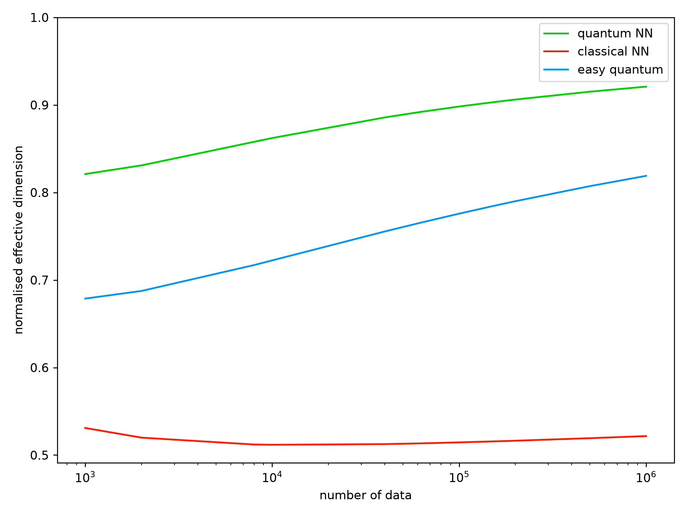
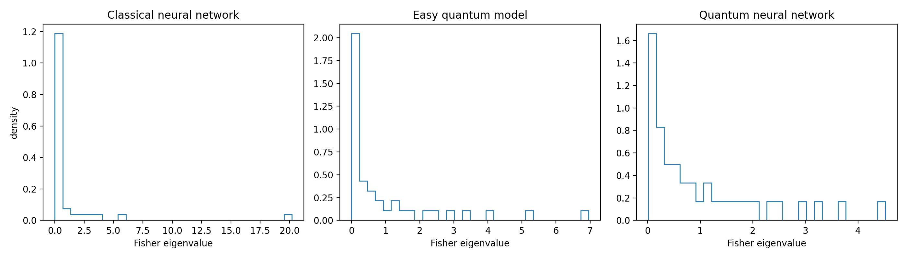
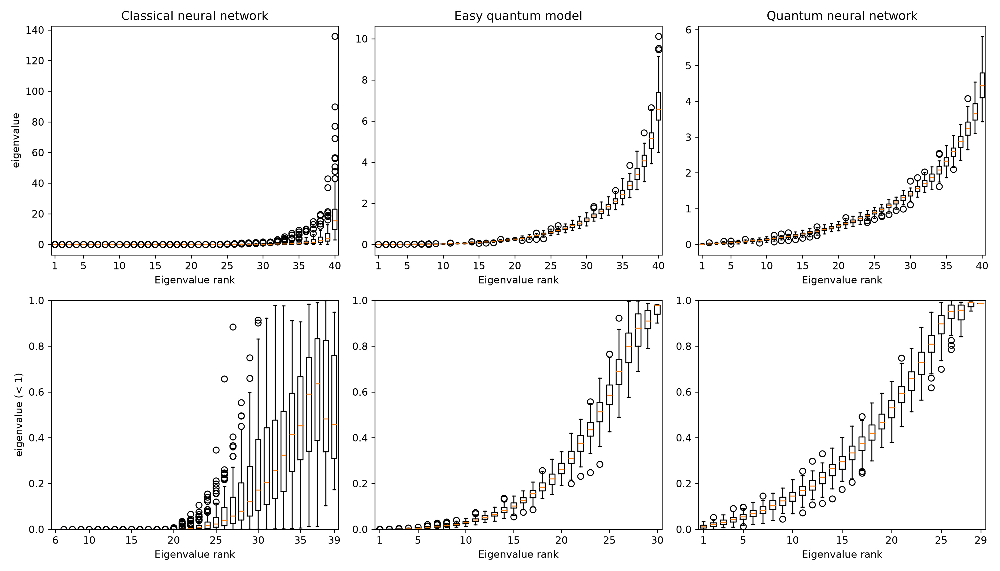
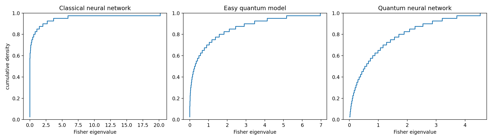
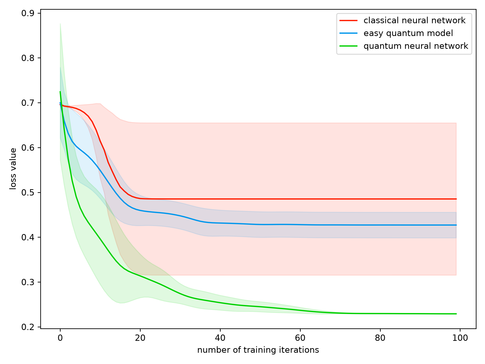

# Quantum Neural Networks: A Comparative Study with Classical Architectures

Research code and reproduced analyses from a quantum-machine-learning project carried out at IISER Bhopal, comparing classical neural networks with quantum neural networks (QNNs) through their information geometry, model capacity, and trainability.

The project investigates how the choice of quantum feature map and model parameterization affects:

- parameterized quantum circuits and variational models;
- Fisher information matrices and their eigenvalue spectra;
- effective dimension as a measure of model capacity;
- classical, easy-QNN, and more expressive QNN architectures;
- optimization landscapes, trainability, and barren-plateau behaviour.

## Repository structure

```text
qnn_repro/                    QNN and classical-network implementation
experiments/
  effective_dimension/        effective-dimension experiments
  fisher_spectrum/            Fisher-information spectrum experiments
  trainability/               classical/QNN training experiments
figures/                      reproduced project results
tests/                        numerical and smoke tests
.github/workflows/            automated test workflow
requirements.txt
ATTRIBUTION.md
```

The methodology follows Abbas *et al.*, *The power of quantum neural networks* (Nature Computational Science, 2021). The original authors' source repository is linked in `ATTRIBUTION.md`; it is not vendored into this repository.

## Implementation

`qnn_repro/` contains the main numerical components used in the study:

- `quantum_nn.py` — parameterized quantum-circuit evaluation, parameter-shift gradients, output probabilities, and Fisher information matrices;
- `classical_nn.py` — classical feed-forward neural-network baseline;
- `effective_dimension.py` — Fisher normalization and effective-dimension calculations;
- `optimizer.py` — Adam optimization used in the training experiments;
- `model_base.py` — common model interface.

Quantum circuits are evaluated with Qiskit and Qiskit Aer. The QNN output is obtained by grouping computational-basis probabilities according to parity, while gradients are evaluated using the parameter-shift rule.

The implementation includes numerical checks for QNN probabilities, gradients, Fisher matrices, effective dimension, and agreement between the Aer and direct-statevector evaluation paths.

## Experiments

### Effective dimension

```bash
python experiments/effective_dimension/ed_cnn.py --num-inputs 10 --num-thetas 10
python experiments/effective_dimension/ed_easy_qnn.py --num-inputs 10 --num-thetas 10 --blocks 2
python experiments/effective_dimension/ed_qnn.py --num-inputs 10 --num-thetas 10 --blocks 2
```

The effective dimension uses the normalized Fisher information matrix to estimate how much of the available model space is effectively occupied by a parameterized model. This provides a common information-geometric measure with which classical and quantum architectures can be compared.

### Fisher-information spectrum

```bash
python experiments/fisher_spectrum/fisher_cnn.py --num-inputs 10 --num-thetas 10
python experiments/fisher_spectrum/fisher_easy_qnn.py --num-inputs 10 --num-thetas 10 --blocks 2
python experiments/fisher_spectrum/fisher_qnn.py --num-inputs 10 --num-thetas 10 --blocks 2
```

For each model, Fisher information matrices are evaluated over different parameterizations and their eigenvalue distributions are examined. Eigenvalues close to zero correspond to parameter directions in which the model output changes very little, while the overall distribution provides information about the geometry and conditioning of the optimization landscape.

### Trainability

```bash
python experiments/trainability/classical_loss.py --runs 2 --epochs 10
python experiments/trainability/easy_qnn.py --runs 1 --maxiter 5 --samples-per-class 5
python experiments/trainability/hard_qnn.py --runs 1 --maxiter 5 --samples-per-class 5
```

The training experiments compare loss evolution for the classical and quantum architectures and connect the observed optimization behaviour to the Fisher-information analysis.

Generated numerical data are written under `results/`.

## Results

The figures below are representative reproduced outputs from the analyses carried out in the project.

### Effective dimension



The normalized effective dimension is compared for the classical feed-forward network, the easy quantum model, and the QNN with the more expressive feature map. The calculation uses the Fisher information metric to compare the effective capacity of models with the same number of trainable parameters.

Rather than simply counting parameters, effective dimension measures how many distinguishable directions in model space are actually accessible as the amount of available data changes.

### Fisher-information spectrum



The Fisher-information eigenvalue distributions compare the local geometry of the three model classes over randomly sampled parameterizations.

A strong concentration of eigenvalues close to zero corresponds to many insensitive or locally flat parameter directions. Large isolated eigenvalues indicate strong anisotropy in the parameter space. The comparison therefore provides a geometric way of studying optimization behaviour beyond simply comparing training loss.

### Fisher-information boxplots



The boxplots show the distribution of sorted Fisher eigenvalue ranks across the sampled parameterizations, making differences in near-zero directions and spectral spread easier to compare.

### Cumulative Fisher spectrum



The cumulative spectrum provides a complementary view of the Fisher eigenvalues, showing how the total distribution is accumulated across eigenvalue magnitude.

This makes differences in spectral concentration between the classical network and the two quantum encodings easier to visualize.

### Trainability comparison



The training-loss comparison shows the mean and standard deviation across five independent optimization runs. The quantum neural network with the more expressive feature map converges to the lowest final loss (0.2290) with very small run-to-run variation, while the easy quantum model reaches an intermediate loss (0.4270). The classical network has the highest mean final loss (0.4852) and substantially larger variance because some runs remain close to the chance-level solution.

Together with the Fisher-spectrum results, this supports a connection between a less-degenerate Fisher geometry and more reliable optimization behaviour.

## Installation

Python 3.11 is recommended.

```bash
python -m venv .venv
# activate the environment
pip install -r requirements.txt
```

## Tests

```bash
pytest -q
```

The tests cover probability evaluation, parameter-shift gradients, Fisher information matrices, effective dimension, and numerical agreement between independent statevector evaluation paths.

## Research context

**Institution:** IISER Bhopal  
**Advisor:** Dr. Kuntal Roy, EECS  
**Project:** Quantum Neural Networks — comparative study with classical architectures

## Reference

A. Abbas, D. Sutter, C. Zoufal, A. Lucchi, A. Figalli, and S. Woerner, “The power of quantum neural networks,” *Nature Computational Science* **1**, 403–409 (2021).
